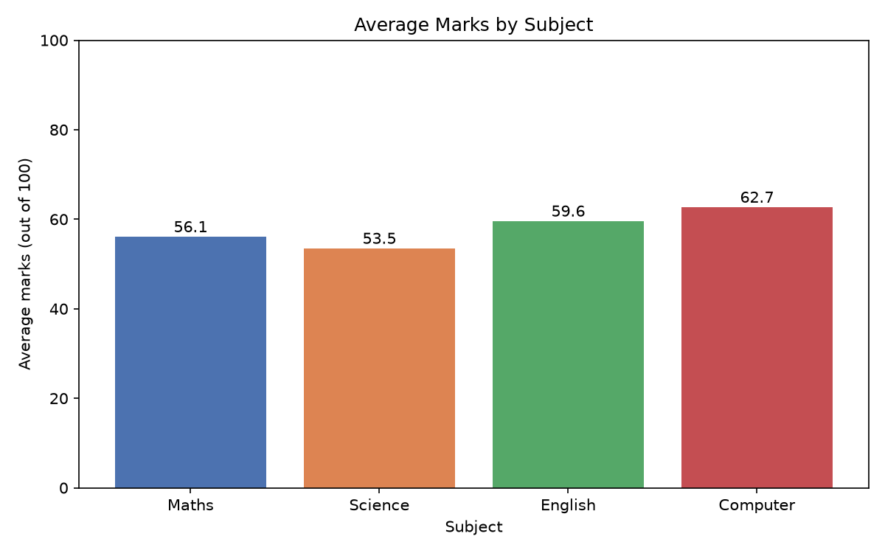
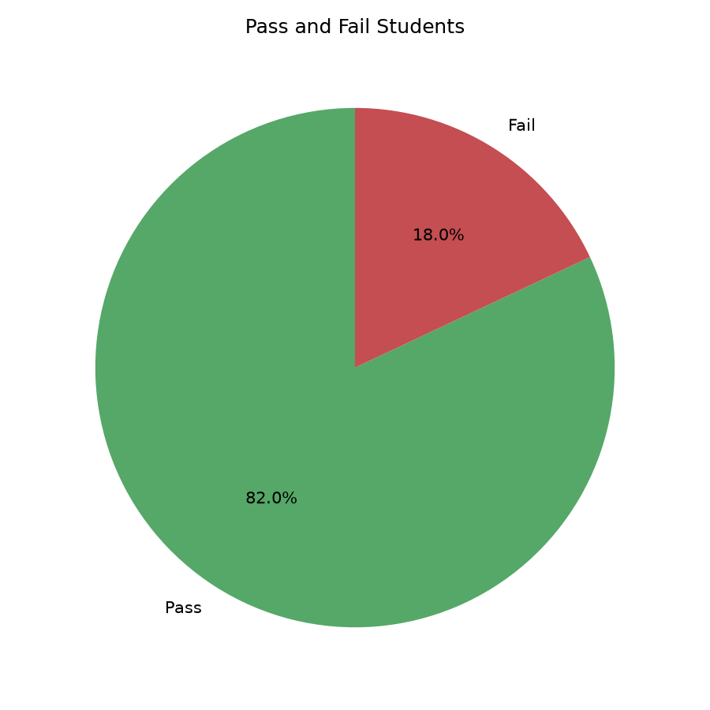
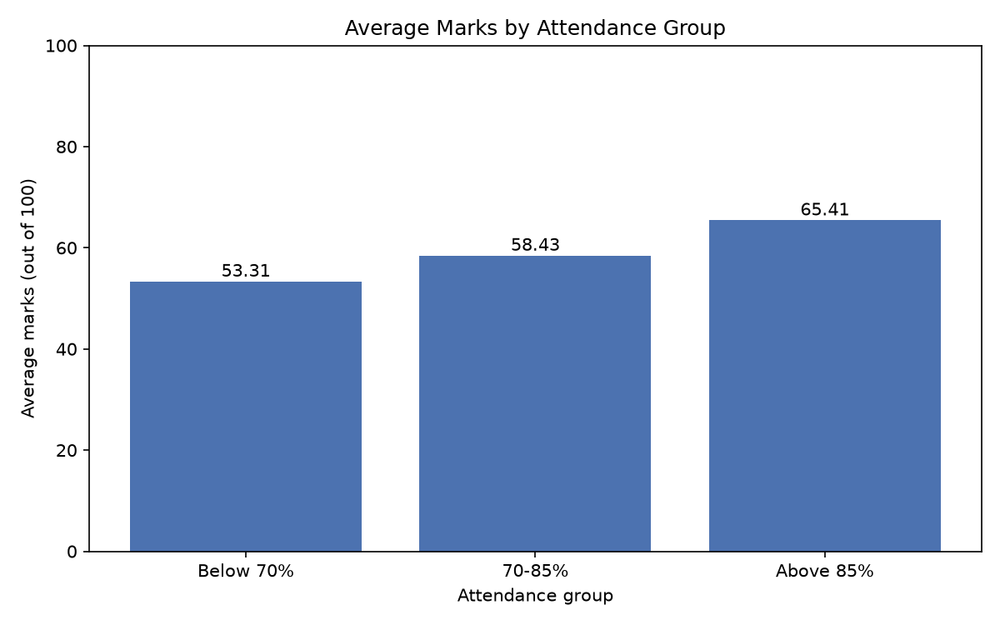
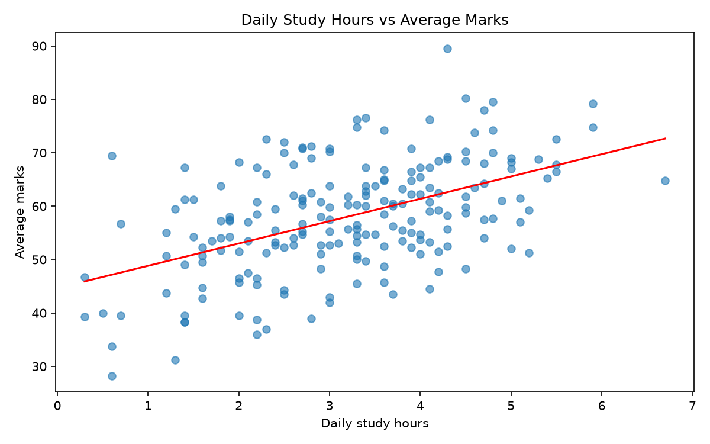
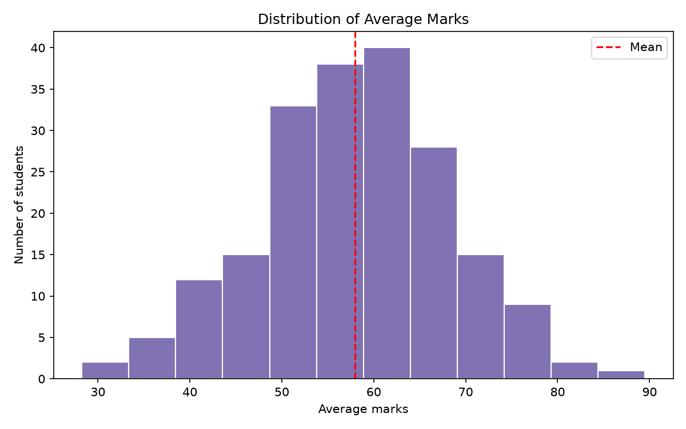
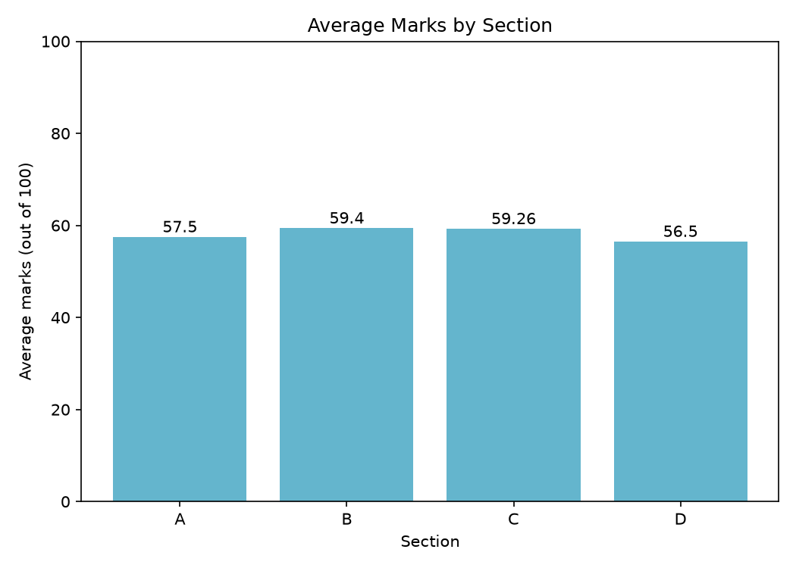

# Student Performance Analysis

HCL Data Analyst Training Project

**Name:** Jay Narayan Tiwari_
**Roll No:** 2026B01010438
**College / Branch / Year:** ABES ENGINEERING COLLEGE / BTECH CSE / Ist year
**Trainer:** Mr. Deepak Gautam
**GitHub link:** [https://github.com/JNT000/-HCL-Project_2026-27)

## About the project
This project analyses the performance of 200 first year students using Python. The dataset has four subject marks, attendance, daily study hours and an assignment score. I cleaned the raw file, created some new columns and answered four questions with tables and charts.

The data is made up (synthetic) for practice. It is not the record of any real student.

## Four questions
1. Which subject has the highest average marks?
2. How many students passed and how many failed?
3. How do the average marks change with attendance?
4. Do students who study more hours get more marks?

## Dataset
| File | What it is |
|---|---|
| `Data/Raw_data/student_performance_raw.csv` | raw file, 203 rows and 10 columns |
| `Data/Clean_data/student_performance_clean.csv` | cleaned file, 200 rows (made by the notebook) |

Columns: Student_ID, Section, Gender, Attendance_Percentage, Daily_Study_Hours, Maths_Marks, Science_Marks, English_Marks, Computer_Marks, Assignment_Score

Problems in the raw file:
- 3 duplicate rows
- text inside number columns (`82%`, `3 hrs`, `absent`)
- different spellings in Section and Gender (` a`, `B `, `M`, `FEMALE`)
- impossible values (attendance 125 and -20, study hours 18 and -2, marks 150, -10 and 999)
- 29 values missing in total after the above fixes (Attendance 7, Maths 6, Study hours 5, Science 3, Assignment 3, Computer 2, English 1, Section 1, Gender 1)

## Project folders
```
Student_Performance_Analysis_HCL/
|-- Data/
|   |-- Raw_data/
|   |-- Clean_data/
|-- Notebook/Student_Performance_Analysis.ipynb
|-- Scripts/
|   |-- generate_raw_data.py
|   |-- clean_data.py
|-- Images/      (6 charts)
|-- Reports/     (summary csv files)
|-- Documents/   (SRS and presentation)
|-- requirements.txt
|-- README.md
```

## How to run
1. Install the libraries: `pip install -r requirements.txt`
2. Start Jupyter: `jupyter notebook`
3. Open `Notebook/Student_Performance_Analysis.ipynb` and run all cells from top to bottom.

To run only the cleaning as a script, open the terminal in the main project folder and use `python Scripts/clean_data.py`.

## Cleaning steps
1. Removed 3 duplicate rows (203 to 200 rows)
2. Fixed Section and Gender spellings with `strip()`, `lower()` and a dictionary
3. Removed `%` and `hrs` and converted columns to numbers with `to_numeric`
4. Changed impossible values to missing
5. Filled missing values (median for numbers, mode for Section and Gender)
6. Made new columns: Total_Marks, Average_Marks, Result, Attendance_Group, Study_Group

## Assumptions
- Marks and assignment score are out of 100. Attendance is in percent. Study hours are per day (0 to 12).
- Pass rule: marks of 40 or more in all four subjects (my assumption, not an official rule).
- Impossible values are treated as wrong and made missing.
- Missing numbers are filled with the median. Missing Section and Gender are filled with the most common value.

## Results
- Class average marks: about 58 out of 100
- Highest subject average: Computer (62.7). Lowest: Science (53.5)
- 164 students passed and 36 failed (82% pass)
- Average marks by attendance: below 70% = 53.3, 70-85% = 58.4, above 85% = 65.4
- Average marks by study time: below 2 hrs = 50.0, 2-4 hrs = 57.9, above 4 hrs = 64.2
- Correlation with average marks: study hours 0.50, attendance 0.45
- Assignment score has a high correlation with average marks (about 0.78)
- Section and gender show only small differences

Correlation only shows a relation. It does not prove that one thing causes the other.

## Limitations
- The data is synthetic, so the results are only for practice and cannot be used for real students.
- Correlation shows a relation, not the reason. Other things (like ability or sleep) are not in the data.
- Filling with the median can hide the real values. The attendance and study groups are also my own choice of ranges.
- A student with one weak subject is marked Fail even if the average is good.

## Charts
| | |
|---|---|
|  |  |
|  |  |
|  |  |

## Tools used
Python, Pandas, NumPy, Matplotlib, Jupyter Notebook, Git and GitHub

## What I learned
Loading and checking a csv file, cleaning dirty data, making new columns, using groupby, making charts and saving the results.
